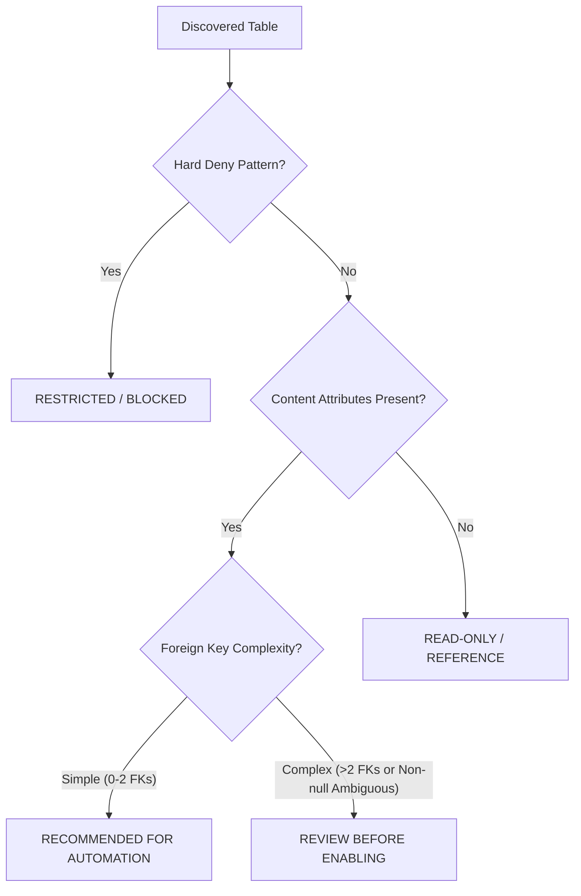

# Database Automation Design — Schema Discovery, Relational Engine & Execution Safety

**Date:** October 9, 2026  
**Document Owner:** Principal Database & Systems Architect  

---

## 1. Relational Introspection & Snapshot Architecture

### 1.1 Read-Only Introspection
The control plane introspects target customer databases using scoped PDO connections to MySQL's read-only `information_schema` views:
- `information_schema.tables`: Table names, approximate rows, table types (`BASE TABLE`).
- `information_schema.columns`: Column names, data types, physical column types (e.g. `varchar(255)`, `enum(...)`), nullability, primary key markers, default values, max character lengths.
- `information_schema.key_column_usage`: Discovered foreign key relationships linking child columns (`category_id`, `author_id`) to parent tables (`categories`, `users`) and primary columns (`id`).

### 1.2 Versioned Snapshots & Drift Tracking
- Discovered schemas are persisted in the platform database (`schema_snapshots` table).
- Each snapshot stores:
  - `connection_id`, `version_number`, `created_at`
  - Complete JSON representation of tables, columns, and foreign keys.
- When a user clicks **Refresh Schema**:
  1. The scanner fetches current `information_schema` metadata.
  2. The system compares it with the latest snapshot:
     - Detects added, removed, or renamed tables.
     - Detects added, removed, or modified columns (type/nullability changes).
  3. If schema changes invalidate an active automation's field mappings, the automation status transitions to `NEEDS_ATTENTION`.

---

## 2. Four-Tier Table Eligibility Classification

Rather than a simple binary flag, the platform uses a deterministic, rule-based policy engine:



### Classification Rules:
1. **RESTRICTED (Hard Deny):**
   - Matches keywords: `user`, `account`, `auth`, `password`, `credential`, `session`, `token`, `oauth`, `role`, `permission`, `payment`, `transaction`, `billing`, `card`, `invoice`, `wallet`, `audit`, `log`, `migration`.
   - Automated writes are strictly prohibited by code. Model prompts cannot override.
2. **RECOMMENDED FOR AUTOMATION:**
   - Content and catalog tables containing descriptive columns (e.g., `title`, `name`, `content`, `body`, `excerpt`, `description`, `slug`, `status`).
   - Foreign key dependencies are safe and resolvable (e.g. `category_id`).
3. **REVIEW BEFORE ENABLING:**
   - Tables with complex non-null foreign keys (e.g., pivot tables like `post_tags` or junction records) requiring explicit parent resolution.
4. **READ-ONLY / REFERENCE:**
   - Auxiliary lookup tables or reference datasets.

---

## 3. Intelligent Relational Record Resolution

When an automation writes to a child table with foreign key columns (e.g., `posts.category_id -> categories.id`):

### Resolution Lifecycle:
1. **Discovered Metadata Extraction:**
   - Detect referenced table (`categories`) and referenced column (`id`).
   - Identify candidate lookup columns (`slug`, `name`, `title`).
2. **Lookup Execution:**
   - Incoming value can be an explicit ID (e.g. `1`) or an AI-generated category name (e.g., `"Cloud Architecture"`).
   - If a name is supplied, normalize it (e.g., slug = `"cloud-architecture"`).
   - Query target table using parameterized SQL:
     ```sql
     SELECT id, name FROM `categories` WHERE `slug` = :slug OR `name` = :name LIMIT 1;
     ```
3. **Branch A: Record Exists:**
   - Reuse the real primary key ID from the query result.
4. **Branch B: Record Missing:**
   - Check automation policy:
     - `REUSE_EXISTING_ONLY`: Query safe default or reject operation.
     - `CREATE_IF_MISSING`:
       - Check table eligibility: target entity cannot be restricted!
       - Check allowed columns in referenced table (e.g. `name`, `slug`).
       - Execute parameterized insert in the same transaction:
         ```sql
         INSERT INTO `categories` (`name`, `slug`) VALUES (:name, :slug);
         ```
       - Retrieve `lastInsertId` and assign to child foreign key column.
       - Handle unique constraint race condition (`SQLSTATE 23000`): Re-read existing row if concurrent insert occurred.
5. **Atomic Commit:**
   - Commit child post and parent category transactionally. Roll back on any failure.

---

## 4. Execution Safety Invariants

1. **Non-Negotiable SQL Restrictions:**
   - Under no circumstances will the customer database execute `DELETE`, `DROP`, `TRUNCATE`, `ALTER`, `CREATE TABLE`, `RENAME`, `GRANT`, `REVOKE`, or arbitrary SQL.
2. **Parameterized Operations Only:**
   - All `INSERT` and scoped `UPDATE` statements are built using PDO bound parameters (`:param`).
   - No string concatenation of AI-generated content into SQL.
3. **AST Safety Interceptor:**
   - `DatabaseSafetyService.assertQueryIsSafe()` scans every constructed SQL statement before execution.
4. **Ephemeral Connections:**
   - PDO handles are instantiated inside try-finally blocks and set to `null` immediately upon completion, preventing cross-request leaks.
