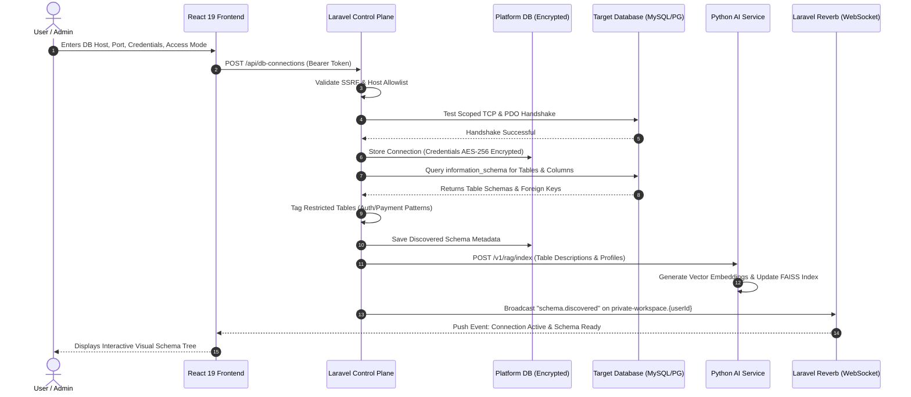
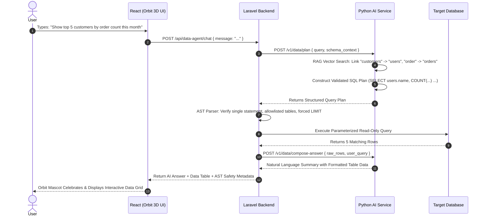
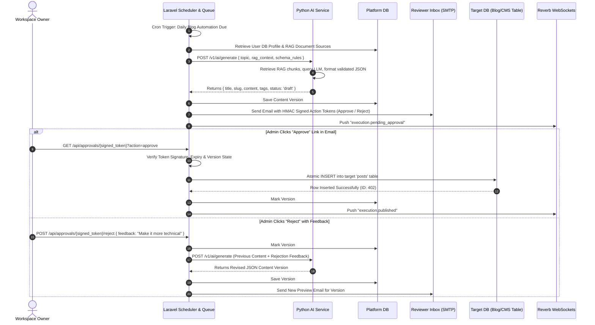
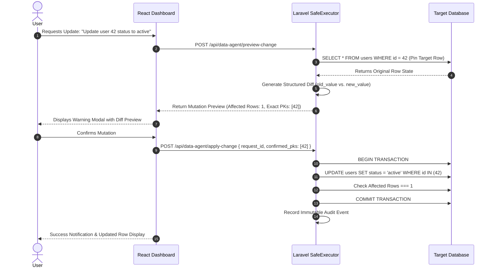

# AI-Powered Database Automation Platform
## Complete Project Architecture, System Flow, and Technical Specification

---

## 1. Executive Summary & Project Overview

### 1.1 What is the Platform?
The **AI-Powered Database Automation Platform** is a multi-tenant enterprise system that enables organizations and individuals to connect their operational relational databases (MySQL, PostgreSQL), discover schemas, and safely run autonomous AI data automations and natural language queries without writing raw SQL or risking database integrity.

The platform includes **Orbit**, an interactive 3D autonomous database agent, along with scheduled workflow automation, automated content publishing (blogs, product descriptions, FAQs), human-in-the-loop email approvals, and real-time push events via WebSockets.

### 1.2 Core Problem Solved
- **SQL Barrier:** Business users and non-technical staff cannot query complex databases without relying on data engineers.
- **AI Safety Concerns:** Directly connecting LLMs to production databases with unrestricted write or DDL access can lead to catastrophic data loss (`DROP`, unconstrained `UPDATE`, SQL injection).
- **Manual Overhead:** Repetitive database-driven content generation and batch updates require constant manual intervention.
- **Multi-Tenant Privacy:** Enterprise teams require complete data isolation; credentials and database structures must never leak across workspaces or be used to train external models.

### 1.3 Key Value Pillars
1. **Strict Tri-Tier Security:** AI models generate plans, but the backend control plane strictly validates, compiles, and executes queries. The AI service has **zero direct access** to customer databases.
2. **Guarded Mutations:** Writes (`INSERT`/`UPDATE`) require structured previews and primary-key pinning; destructive operations (`DELETE`) are restricted to explicit opt-in modes with impact analysis and typed confirmations.
3. **Bring Your Own Model (BYOM):** Works out-of-the-box with local, zero-cost Ollama models (e.g., `llama3`, `mistral`, `qwen2.5-coder`) as well as cloud providers (OpenAI, Gemini, Anthropic).
4. **Real-Time Push Architecture:** Zero-polling live updates powered by Laravel Reverb WebSockets.

---

## 2. High-Level Architectural Roles & Separation of Concerns

The platform is cleanly decoupled into three specialized layers:

```mermaid
flowchart TB
    subgraph Tier1 ["Presentation Layer (React 19 + TypeScript)"]
        UI_SPA["Vite SPA Portal (:5173)"]
        UI_Orbit["Orbit 3D Mascot & Chat Interface"]
        UI_Schema["Schema Explorer & Visual Query Trees"]
        UI_Auto["Workflow Wizard & Schedule Manager"]
        UI_Echo["Laravel Echo WebSocket Listener"]
    end

    subgraph Tier2 ["Control Plane Backend (Laravel 11 / PHP 8.3)"]
        L_Auth["Sanctum Auth & Multi-Tenancy Policy"]
        L_Vault["Encrypted Credential Vault (AES-256)"]
        L_Conn["Scoped Target DB Connection Manager"]
        L_Intro["Schema Introspection & Classification"]
        L_Exec["Safe Database Executor & AST Gatekeeper"]
        L_Queue["Database Queue & Fair Cohort Scheduler"]
        L_Reverb["Laravel Reverb WebSocket Server (:8080)"]
        L_Mail["Email Approval Service & HMAC Tokens"]
        L_Audit["Tenant Security Audit Logger"]
    end

    subgraph Tier3 ["Dedicated AI Microservice (Python 3.12 / FastAPI)"]
        P_FastAPI["FastAPI HTTP Server (:8001)"]
        P_Token["Service-to-Service Token Auth"]
        P_Router["Model Provider Router (Ollama/OpenAI/Gemini/Claude)"]
        P_SQL["NL-to-SQL Planner & Query Analyzer"]
        P_RAG["RAG Vector Engine (FAISS / PyMuPDF)"]
        P_JSON["Structured Output Schema Validator"]
    end

    subgraph Storage ["Databases & External Systems"]
        PlatformDB[("Platform Persistence DB (MySQL 8)")]
        TargetDB[("Customer Target Databases (MySQL / PostgreSQL)")]
        OllamaLocal["Local Ollama Instance (:11434)"]
        SMTPHost["SMTP / Mailpit Mail Catcher"]
    end

    UI_SPA -->|REST API with Bearer Token| L_Auth
    UI_Echo <-->|WebSockets (ws://:8080)| L_Reverb
    L_Auth --> PlatformDB
    L_Queue --> PlatformDB
    L_Conn -->|Encrypted Scoped PDO| TargetDB
    L_Exec -->|Parameterized Atomic SQL| TargetDB
    L_Intro -->|Read-Only Schema Metadata| TargetDB
    L_Mail -->|Approval Notification Emails| SMTPHost
    
    L_Auth -->|Internal HTTP with X-Service-Token| P_FastAPI
    P_Router --> OllamaLocal
```

---

## 3. Deep Dive: Layer-by-Layer Responsibilities

### 3.1 Tier 1: React 19 + TypeScript (Frontend)
- **Role:** User presentation, real-time interactivity, visual feedback, and workspace administration.
- **Port:** `5173` (Vite Development Server / Static Nginx Production).

#### Core Responsibilities & Features:
1. **Public Marketing & Onboarding:**
   - High-conversion landing page presenting value proposition, architecture, security posture, and local AI capabilities.
   - Clean self-service registration and login forms with client-side validation.
2. **Dashboard & Metrics:**
   - Real-time statistics: active automations, database connections, generation counts, and execution success rates.
   - Quick-action shortcuts to launch automations or connect databases.
3. **Database Connection & Schema Explorer:**
   - Step-by-step database connection wizard (Host, Port, Database, Username, Password, SSL).
   - Interactive schema tree showing tables, columns, primary keys, foreign-key relationships, and sensitive column classifications.
4. **Orbit 3D Autonomous Mascot & Chat Console:**
   - Interactive 3D robot mascot built with Three.js / Framer Motion that reacts dynamically with contextual poses (`idle`, `thinking`, `celebrating`, `warning`, `error`).
   - Natural language database querying chat interface with streaming thought-steps, query previews, and table profile linking.
5. **Automation Wizard & Content Studio:**
   - Visual workflow builder: prompt engineering, field mapping, RAG knowledge selection, schedule configuration (cron/timezone).
   - Version history explorer: visual diffing between content versions, rollback, and manual execution triggers.
6. **Approval & Review Screen:**
   - In-app review for generated data/content with side-by-side preview, edit mode, and rejection feedback submission.
7. **Real-Time Push Integration (Laravel Echo):**
   - Subscribes to private channel `workspace.{userId}` via WebSockets.
   - Receives instant notifications for execution completions, schema refreshes, and agent actions without HTTP polling.

---

### 3.2 Tier 2: Laravel 11 + PHP 8.3 (Control Plane Backend)
- **Role:** Security boundary, business logic, tenant isolation, database connection management, job scheduling, execution safety, and real-time broadcasting.
- **Port:** `8000` (Laravel REST API) & `8080` (Laravel Reverb WebSocket Server).

#### Core Responsibilities & Features:
1. **Multi-Tenant Authentication & Authorization:**
   - Laravel Sanctum SPA Bearer token authentication.
   - Strict query scoping: all queries, automations, and connections are scoped to the authenticated `user_id`.
   - Anti-IDOR security: resource ownership verified at controller and job levels.
2. **Encrypted Credential Vault:**
   - Customer database passwords and AI API keys are encrypted at rest using AES-256 (`Illuminate\Support\Facades\Crypt`).
   - Secrets are masked immediately upon saving and **never** returned in plaintext over the API.
3. **Dynamic Database Connection Manager:**
   - Establishes isolated, ephemeral PDO connections to customer MySQL or PostgreSQL targets on-demand.
   - Uses scoped connection cleanup to ensure credentials never persist in global application state.
4. **Schema Introspection & Table Profiling:**
   - Queries target `information_schema` to discover tables, column types, nullability, defaults, keys, and foreign-key constraints.
   - Automatically detects and tags sensitive tables (`passwords`, `tokens`, `sessions`, `transactions`) as restricted or blocked.
   - Dispatches background indexing jobs to create natural-language table summaries for vector search.
5. **Safe Database Execution Engine (`SafeDatabaseExecutor`):**
   - **AST Query Validation:** Parses and validates model-suggested SQL against strict allowlists.
   - **Prohibited Operations:** Hard-blocks any `DROP`, `TRUNCATE`, `ALTER`, `CREATE`, `RENAME`, `GRANT`, `REVOKE` or other DDL statements.
   - **Guarded Mutations:** Enforces primary-key pinned `UPDATE` and structured `INSERT` with pre-execution diffs and strict row-count verification.
   - **Guarded Deletions:** Prohibits `DELETE` unless connection is in `read_write_delete` mode, with impact analysis and typed user confirmation.
   - **Atomic Transactions:** Wraps multi-row writes in atomic transactions with automatic rollback on error.
6. **Background Automation & Scheduling:**
   - Native queue worker processing background generations, schema scans, and data syncs.
   - Fair cohort scheduling (`QueueFairnessService`) preventing individual users from monopolizing worker capacity.
   - Full IANA timezone support (e.g., `Asia/Kolkata`, `UTC`, `America/New_York`).
7. **Approval & Email Delivery Engine:**
   - Generates cryptographically signed, expiring HMAC action tokens (`/approvals/{token}`).
   - Sends HTML preview emails with one-click approve/reject actions.
   - Handles version regeneration loops with retry limits upon rejection.
8. **Real-Time Push Server (Laravel Reverb):**
   - High-throughput WebSocket server managing authenticated user channels (`private-workspace.{userId}`).
   - Dispatches `WorkspaceLiveEvent` instances when background jobs change state.
9. **Audit Trail Logging:**
   - Immutable records of all actions: user logins, connection updates, schema scans, AI prompts, mutations, and approvals.

---

### 3.3 Tier 3: Python 3.12 + FastAPI (Dedicated AI Microservice)
- **Role:** AI inference, prompt engineering, RAG indexing, natural-language-to-SQL planning, schema linking, and structured JSON generation.
- **Port:** `8001` (Internal private microservice).
- **Security Invariant:** **Has ZERO access to customer databases.** It only receives schema metadata from Laravel and returns validated plans/text.

#### Core Responsibilities & Features:
1. **Service Authentication & Isolation:**
   - Private internal-only service protected by `X-Service-Token` header verification middleware.
2. **LLM Provider Abstraction:**
   - Native integration with local **Ollama** (`http://localhost:11434`) supporting local models (`llama3.2`, `mistral`, `qwen2.5-coder`, `nomic-embed-text`).
   - Pluggable cloud adapters for OpenAI (`gpt-4o`), Google Gemini (`gemini-1.5-pro`), and Anthropic (`claude-3-5-sonnet`).
   - High-fidelity Mock provider for offline testing and deterministic CI/CD test runs.
3. **Natural Language Data Planner & Query Analyzer:**
   - Analyzes user natural language requests and converts them into structured execution plans.
   - Resolves ambiguous column and table references using live schema metadata.
   - Generates read-only SELECT queries and structured mutation payloads.
4. **RAG Vector Engine (Retrieval-Augmented Generation):**
   - Ingests Markdown, TXT, and PDF documents (parsed via PyMuPDF).
   - Generates 384-dimensional or 768-dimensional local embeddings.
   - Maintains tenant-isolated vector indexes (FAISS / Qdrant) partitioned by `user_id`.
   - Performs cosine-similarity retrieval to ground AI generation in user-uploaded knowledge bases.
5. **Table Profile Vector Indexing:**
   - Stores vector representations of database table descriptions and schemas.
   - Enables semantic schema linking so the agent knows which table to query even when the user uses colloquial names (e.g., "shoppers" $\rightarrow$ `users`).
6. **Structured Output Enforcement:**
   - Uses Pydantic v2 schemas to enforce strictly typed JSON responses from LLMs.
   - Validates generated records against target database column types, character limits, and nullability before returning to Laravel.

---

## 4. End-to-End System Flows

### Flow 1: User Onboarding, Dynamic Connection & Schema Discovery



---

### Flow 2: Natural Language Querying via Orbit AI Agent



---

### Flow 3: AI Content Automation, Email Approval & Publication Loop



---

### Flow 4: Safe Mutation Protocol (Preview $\rightarrow$ Confirmation $\rightarrow$ Execution)



---

## 5. Technology Stack, Libraries, and Tools Inventory

### 5.1 Frontend Technology Inventory
| Category | Technology / Package | Version | Purpose in Platform |
|---|---|---|---|
| **Core Framework** | React | `^19.2.8` | Component architecture, state management, modern concurrent rendering |
| **Language** | TypeScript | `~6.0.2` | Complete static typing, interface contracts, safe API schemas |
| **Build Tool** | Vite | `^8.3.0` | Ultra-fast HMR, asset bundling, and production optimization |
| **Styling** | TailwindCSS + PostCSS | `^3.4.19` | Design tokens, responsive utilities, dark mode theming |
| **3D Graphics** | Three.js | `0.180.0` | Powers the Orbit 3D autonomous mascot mesh rendering |
| **Animation** | Framer Motion | `^14.0.0` | Smooth UI transitions, character gestures, and micro-interactions |
| **Icons** | Lucide React | `^1.54.0` | Comprehensive enterprise icon library |
| **Real-Time Client**| Laravel Echo | `^2.6.1` | Manages WebSocket connections and channel subscriptions |
| **WebSocket Driver**| Pusher-JS | `^8.6.0` | Underlying protocol client communicating with Laravel Reverb |
| **Routing** | React Router DOM | `^7.18.4` | Client-side routing, protected dashboard route guards |
| **Linter** | Oxlint | `^1.81.0` | High-speed Rust-based JavaScript/TypeScript linter |

---

### 5.2 Backend Control Plane Technology Inventory
| Category | Technology / Package | Version | Purpose in Platform |
|---|---|---|---|
| **Framework** | Laravel Framework | `^11.31` | Control plane backend, routing, dependency injection, models |
| **Language** | PHP | `8.3` | Server-side execution, typed properties, JIT execution |
| **Real-Time Server**| Laravel Reverb | `^1.12` | High-throughput native WebSocket server on port 8080 |
| **Authentication** | Laravel Sanctum | `^4.0` | Multi-tenant token authentication and SPA authorization |
| **CLI Runtime** | Laravel Tinker | `^2.9` | Interactive REPL debugging |
| **Date & Time** | Carbon (Nesbot) | Integrated | Multi-timezone scheduling calculations and fair cohort timing |
| **Code Style** | Laravel Pint | `^1.13` | Automated PSR-12 code style enforcement |
| **Testing** | PHPUnit | `^11.0.1` | Comprehensive feature, security, and unit test suites |
| **Mocking** | Mockery | `^1.6` | Mocking internal services, mailers, and HTTP clients in tests |

---

### 5.3 Python AI Microservice Technology Inventory
| Category | Technology / Package | Version | Purpose in Platform |
|---|---|---|---|
| **Web Framework** | FastAPI | `^0.110.0`| High-performance asynchronous microservice framework |
| **ASGI Server** | Uvicorn | `^0.28.0`| Fast ASGI HTTP server running the Python service on port 8001 |
| **Data Validation** | Pydantic | `^2.6.0` | Strict schema validation, request/response models, JSON generation |
| **HTTP Client** | HTTPX | `^0.27.0`| Async HTTP client communicating with Ollama and external LLM APIs |
| **Vector Indexing** | FAISS (CPU) | `^1.8.0` | Fast local vector similarity search for tenant RAG documents |
| **Vector Store** | Qdrant Client | `Latest` | Scalable vector search alternative for table profile matching |
| **PDF Extraction** | PyMuPDF (fitz) | `^1.23.0`| Fast, memory-safe text extraction from user-uploaded PDFs |
| **Math & Matrices** | NumPy | `^1.26.0`| High-speed vector normalization and tensor calculations |
| **Test Runner** | Pytest | `^8.0.0` | Unit and integration test suite for Python AI adapters |

---

### 5.4 Databases, Storage & Infrastructure Tools
| Tool / System | Version / Type | Role in Platform |
|---|---|---|
| **Platform DB** | MySQL 8.0 | Persists users, workspaces, encrypted credentials, automations, executions |
| **Customer Target DB** | MySQL / PostgreSQL | Customer databases connected by users for data automations and queries |
| **Local LLM Engine**| Ollama (`:11434`) | Free, zero-paid-API local LLM host (`llama3.2`, `mistral`, `qwen2.5-coder`) |
| **Email Catcher** | Mailpit / SMTP | Local and production mail delivery for review and approval workflows |
| **Process Manager** | `run_all.sh` / Supervisor | Orchestrates concurrent launch of Frontend, Laravel, Python, Reverb, Queue |

---

## 6. Comprehensive Feature & Functionality Matrix

The following table delineates exactly which system layer handles each specific capability:

| Feature / Capability | Frontend (React) | Backend (Laravel) | AI Service (Python) | Description |
|---|:---:|:---:|:---:|---|
| **Self-Service Registration & Auth** | 🟢 UI Forms | 🟢 Sanctum Tokens | ⚪ N/A | Register, login, logout, password hashing, token issue |
| **Tenant Resource Isolation** | 🟢 Context Filtering | 🟢 Scoped SQL & Policies | ⚪ Stateless | Strict `user_id` query scoping; prevents IDOR attacks |
| **Encrypted Credential Storage** | ⚪ Never Sees Secrets | 🟢 AES-256 at Rest | ⚪ Ephemeral in-memory | Database passwords and API keys encrypted; never leaked |
| **Dynamic DB Connectivity** | 🟢 Setup Wizard | 🟢 Scoped PDO Manager | ⚪ Zero Access | Connects to any customer MySQL/Postgres instance |
| **Schema Introspection** | 🟢 Visual Tree View | 🟢 Read-only Metadata Scan | ⚪ Consumes JSON | Reads tables, columns, data types, keys, and foreign keys |
| **Table Profile Embedding** | ⚪ Status Indicator | 🟢 Job Dispatcher | 🟢 Vector Embedding | Creates natural-language semantic table index |
| **Orbit 3D Mascot Character** | 🟢 Three.js Canvas | 🟢 Reaction Event Stream | ⚪ Intent Tagging | Visual interactive mascot with contextual poses |
| **Natural Language Queries** | 🟢 Chat Interface | 🟢 Execution & Safety Gate | 🟢 SQL & Plan Generator | Translates natural language into safe, optimized queries |
| **AST SQL Safety Gatekeeper** | ⚪ Displays Flags | 🟢 Single-Statement AST | ⚪ Synthesizes Plan | Blocks DDL (`DROP`), forces limits, checks allowlists |
| **Safe Mutation Preview** | 🟢 Visual Diff Modal | 🟢 Target Row Resolution | ⚪ Payload Suggestion | Displays before/after diffs pinned to primary keys |
| **Guarded Deletions** | 🟢 Typed Confirmation | 🟢 Impact Analysis | ⚪ Plan Formulation | Deletes allowed only in explicit mode with count check |
| **RAG Document Ingestion** | 🟢 Drag & Drop Upload | 🟢 File Storage & Dispatch | 🟢 Chunk & FAISS Index | Ingests PDF, TXT, and Markdown knowledge sources |
| **Local / Cloud LLM Router** | 🟢 Provider Selector | 🟢 Encrypted Key Storage | 🟢 Ollama/Cloud Client | Seamlessly switches between local Ollama and cloud APIs |
| **Structured JSON Generation** | ⚪ Consumes Output | 🟢 Schema Verification | 🟢 Pydantic Validation | Emits typed JSON strictly matching target table columns |
| **Scheduled Background Queue** | 🟢 Schedule Config UI | 🟢 Persistent Jobs & Cron | ⚪ Worker Task Target | Autonomous execution independent of open browser tabs |
| **Fair Cohort Queueing** | ⚪ Status Indicators | 🟢 `QueueFairnessService` | ⚪ N/A | Prevents single user from starving shared queue workers |
| **Email Approval Workflow** | 🟢 Review Screen | 🟢 HMAC Expiring Links | ⚪ N/A | One-click email approval/rejection with feedback loop |
| **Version History & Rollback** | 🟢 Visual Version Diff | 🟢 Immutable Versions | ⚪ Context for Retry | Tracks every generated iteration; supports rollback |
| **Real-Time Push Events** | 🟢 Laravel Echo Client | 🟢 Laravel Reverb Server | ⚪ N/A | Instant event broadcast; completely eliminates HTTP polling |
| **Comprehensive Audit Logging** | 🟢 Audit Trail Table | 🟢 Immutable DB Logs | ⚪ Action Metrics | Records all logins, mutations, schema changes, and runs |

---

## 7. Security Invariants & Guardrails (Non-Negotiable)

1. **Zero Customer DB Access in Python:**
   The Python AI microservice has **no network credentials or drivers** to access customer databases. It only analyzes text and schema descriptors forwarded by Laravel.
2. **Never Model-Direct Writes:**
   The system never passes raw model-generated SQL directly to a database write executor. Writes must follow a compiled, parameterized operation plan verified by Laravel.
3. **Primary-Key Pinned Updates:**
   `UPDATE` statements must always resolve target row primary keys in advance (`WHERE id IN (...)`). Unbounded or unindexed updates are strictly forbidden.
4. **Secret Column Masking:**
   Columns identified as containing password hashes, credit cards, or security tokens are permanently excluded from AI context and API payloads.
5. **Ephemerality of Connections:**
   Target database connections are opened only for the duration of the specific operation (introspection or execution) and are immediately closed to prevent pool leaks.

---

## 8. Development & Production Deployment Topology

```
+-----------------------------------------------------------------------+
|                           Host / Server                               |
|                                                                       |
|  +--------------------+   +--------------------+   +----------------+ |
|  | Frontend (Vite)    |   | Laravel API        |   | Laravel Reverb | |
|  | Port 5173          |   | Port 8000          |   | Port 8080 (WS) | |
|  +--------------------+   +--------------------+   +----------------+ |
|            |                        |                       |         |
|            | (Bearer REST)          |                       |         |
|            v                        v                       |         |
|  +---------------------------------------------+            |         |
|  | Control Plane Backend (Laravel 11 / PHP 8)  |<-----------+         |
|  +---------------------------------------------+                      |
|            |                             |                            |
|            | (Encrypted SQL)             | (X-Service-Token HTTP)     |
|            v                             v                            |
|  +-------------------+       +-----------------------+                |
|  | Platform DB       |       | Python AI Service     |                |
|  | MySQL 8 (Port 3306)|      | FastAPI (Port 8001)   |                |
|  +-------------------+       +-----------------------+                |
|                                          |                            |
|                                          | (Local HTTP)               |
|                                          v                            |
|                              +-----------------------+                |
|                              | Ollama LLM Engine     |                |
|                              | Port 11434            |                |
|                              +-----------------------+                |
+-----------------------------------------------------------------------+
```

### Running the Entire Stack Locally:
A single command orchestrates all required services with pre-flight port cleanup and health monitoring:
```bash
./run_all.sh
```
This launches:
1. **Python AI Service** on `http://127.0.0.1:8001`
2. **Laravel Reverb WebSocket Server** on `ws://0.0.0.0:8080`
3. **Laravel Control Plane Backend** on `http://127.0.0.1:8000`
4. **Laravel Background Queue Worker** (`php artisan queue:work`)
5. **React + Vite Frontend** on `http://localhost:5173`
