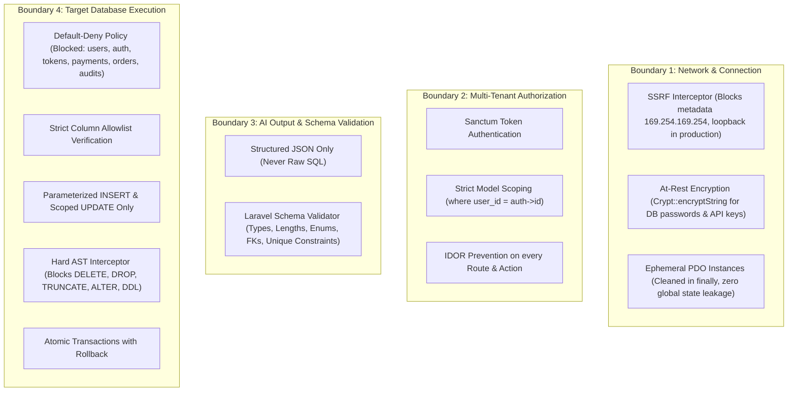

# Security Model: AI-Powered Database Automation Platform

## 1. Threat Model & Security Posture

The platform treats both user inputs and AI outputs as untrusted entities. Because users connect external relational databases and configure automated publishing pipelines, the architecture incorporates defense-in-depth controls at every boundary.

---

## 2. Dynamic Database Security

### 2.1 SSRF & Network Protections
- **Host Validation:** IP addresses and hostnames are validated.
- **Prohibited Destinations:** Hard blocks on AWS/GCP/Azure link-local metadata endpoints (`169.254.169.254`, `fd00::/8`).
- **Port Allowlist:** Restricts connections to standard relational database ports (e.g. 3306, 3307, 3308).
- **Environment Awareness:** Localhost and private subnet addresses (`127.0.0.1`, `192.168.x.x`, `10.x.x.x`) are permitted strictly when `APP_ENV=local` or `ALLOW_LOCAL_TARGET_CONNECTIONS=true`. In production environments, private subnets are blocked unless explicitly routed via an egress connector.

### 2.2 Credential Protection
- Stored credentials (passwords, cloud API keys) are encrypted using AES-256-CBC via Laravel's `Crypt::encryptString()`.
- API endpoints return only masked secrets (e.g. `********`).
- Passwords and connection strings are excluded from system logs and exception stack traces.

### 2.3 Ephemeral Scoped Connections
- Never modifies the global Laravel `config(['database.connections...'])` in a persistent manner.
- Creates temporary PDO connections per execution request and immediately closes them inside `finally` blocks.

---

## 3. Target Database Execution Policy (Tiered Policy, ADR-010)

Per owner-authorised policy change (2026-10-15):

| Operation | Policy |
|---|---|
| SELECT / COUNT / aggregates / schema questions | Allowed. Read-only, validated, limited. |
| INSERT | Allowed after preview and confirmation. |
| UPDATE | Allowed after preview and confirmation, pinned to the exact previewed primary keys. |
| DELETE | Allowed ONLY if the connection owner enabled access mode `read_write_delete`, with impact analysis, typed confirmation, transaction, backup and audit. |
| DROP / TRUNCATE / ALTER / CREATE / GRANT / any DDL | **Always prohibited.** No setting enables them. |
| Raw LLM-written SQL for writes | **Always prohibited.** Writes go through structured operation plans compiled by backend code. |
| Raw LLM-written SELECT | Only through the validated read gate: AST parse, allowlists, forced LIMIT, timeout, read-only transaction. |

### 3.1 Per-Connection Access Modes
- `read_only` (default): reads only.
- `read_write`: reads + insert/update after confirmation.
- `read_write_delete`: adds delete with impact analysis and typed confirmation.
The backend enforces the access mode regardless of the database user's privileges.

### 3.2 Data Classes & Protection
- **Blocked tables:** credentials, tokens, sessions.
- **Read-only tables:** financial, permission, order and audit tables (unless explicitly overridden by the owner).
- **Secret columns:** password hashes, tokens, card numbers, national IDs are never returned, never sent to models, and never written.
- **PII columns:** email and phone are masked by default; reveals are permission-checked and audited.
- **Automation eligibility:** the automation engine continues to restrict sensitive tables from automated background writing.

---

## 4. Email Approval Security & Crawler Protection

### 4.1 Token Security
- Approval links utilize cryptographically signed tokens generated with HMAC-SHA256.
- Tokens expire after 24 hours and are strictly single-use.
- Bound to specific `automation_id`, `version_id`, and `user_id`.

### 4.2 Crawler Neutralization
- To prevent enterprise email filters (such as Microsoft Defender and Google Workspace) from automatically clicking links and approving content, email links navigate to a confirmation page:
  `http://localhost:5173/approvals/{token}`
- The user must explicitly view the draft preview and click **Approve** or **Reject**, submitting an HTTP `POST` request.

---

## Orbit agent security

- **Identity:** the user, workspace and every resource ID are checked server-side (`ToolPolicyGate`) right before each side effect. A model-supplied ID that belongs to another user returns `NOT_FOUND`.
- **Only registered tools:** the model's tool name is constrained to the available registry (schema enum) and re-validated. Arguments are validated against the same schema (types, enums, no extra properties). No tool runs SQL, DDL or deletes against customer databases.
- **Secrets:** passwords and API keys go to `SecretVault` (`agent_secure_inputs`, encrypted cast, per task and user, 30-minute TTL, consumed after a verified save). They come from the masked field, or are redacted out of utterances by both the browser and the server. They are injected into tool arguments only at execution time and scrubbed from tool output. They never appear in task plans or slots, messages, tool-call records, UI actions, timeline, live events or model requests; `AgentAutonomousActionTest::assertSecretNowhere` checks this.
- **Confirmation:** `always_confirm` tools (profile/automation/document removal, published-record edits) always wait for an explicit user confirmation. A spoken "yes" counts only for the exact pending call and only after Orbit asked.
- **Retrieved content is untrusted:** RAG passages and database text are delimited as reference data in the model request and cannot change policy. Retrieval is limited to product docs plus the requesting user's own partition.
- **Browser actions** are allowlisted (`UiActionCoordinator::ALLOWED_ACTIONS`, registered routes only). The model cannot send code or selectors. Visible "press" actions never call the API themselves.

---

## Automation writes: relations, images and review (2026-10-16)
- **Parent creation** only under an explicit `CREATE_IF_MISSING` column policy, never in sensitive, blocked or read-only tables, never with secret columns, never by guessing another foreign key. The child row is written in the same transaction, after its parent.
- **No silent fallbacks:** an unresolvable foreign key, a missing required column, an invalid enum value or a non-unique value is an error before any write. Over-long text is shortened (multibyte-safe) and reported.
- **Secret columns** (`ColumnClassifier`) are never written by automations, previews or manual publishing. The classifier now matches whole tokens, so `company_name`, `panel` or `passenger_count` are no longer misclassified, while `pan`, `pan_number`, `password_hash` and `remember_token` still are.
- **Lookup lists** of parent records never use e-mail columns as labels and refuse blocked tables.
- **Images:** provider keys are the user's own (encrypted at rest, sent per request to the internal AI service, never stored there). Every image is decoded and re-encoded before storage, so the stored file is a valid image of a known type. Uploads are limited to JPEG/PNG/WebP/GIF ≤ 10 MB and checked again by magic bytes.
- **Review links** are single-use, bound to one version, refused once the run has finished, and never written to logs or the audit trail. Approval tokens are no longer returned by the executions API. Email delivery failures are recorded as `APPROVAL_EMAIL_FAILED`, never reported as sent.
- **Publishing** is idempotent per execution (`publish_exec_{id}`), never acts on a finished run, and can never publish a rejected or invalid version ("Publish now" refuses them).
- **Rendered previews** never use `innerHTML`: Markdown is parsed into React elements, and HTML is rebuilt from an allowlist (links limited to http/https/mailto).

## Orbit Remote (phone pairing), 2026-10-21

| Threat | Control |
| --- | --- |
| QR code photographed or leaked | Single use, valid 3 minutes, stored as SHA-256; carried in the URL `#fragment` (not sent in request lines, not in server or proxy logs); the address bar is cleared after claiming. |
| Phone token stolen | Hashed at rest; accepted only by `/api/orbit-remote/device/*` (not Sanctum, no portal API); ends on disconnect from either side, a new pairing, sign-out of the pairing tab, 2 h idle, 12 h total. |
| Acting as another user / tab | Every computer endpoint and the `orbit-remote.{id}` channel check ownership; the phone's socket auth only signs its own channel; requests carry the target tab instance and the server lets one tab take them (late or duplicate acknowledgements are refused). |
| Secrets via voice | Passwords/API keys are refused on the phone and on the server; the secure field stays on the computer. Live "listening" words are redacted before they are shown. |
| Unwanted actions | The phone sends a request; the computer runs it through Orbit's normal gate (permissions, confirmations by the panel Confirm button). Requests are refused when the computer is offline or when they reach it more than 30 s late (server clock). Rate limits: claim 12/min per IP, requests 20/min per phone. |
| Phone page running portal actions | `/orbit/remote` is routed outside the portal providers, so it never heartbeats or runs Orbit UI actions even if the same browser is signed in. |
| Audit | `ORBIT_REMOTE_PAIRING_CREATED`, `ORBIT_REMOTE_PAIRED`, `ORBIT_REMOTE_COMMAND` (id, kind, length), `ORBIT_REMOTE_ENDED`. |
