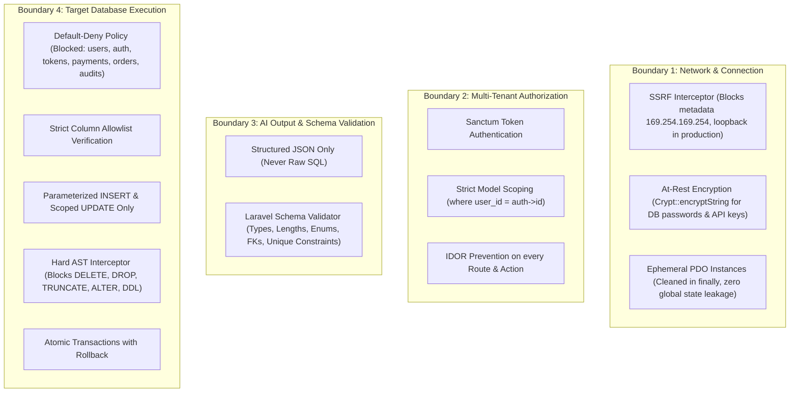

# Security Model: AI-Powered Database Automation Platform

## 1. Threat Model & Security Posture

The platform treats both user inputs and AI outputs as untrusted entities. Because users connect external relational databases and configure automated publishing pipelines, the architecture incorporates defense-in-depth controls at every boundary.

---

## 2. Dynamic Database Security

### 2.1 SSRF & Network Protections
- **Host Validation:** IP addresses and hostnames are validated.
- **Prohibited Destinations:** Hard blocks on AWS/GCP/Azure link-local metadata endpoints (`169.254.169.254`, `fd00::/8`).
- **Port Allowlist:** Restricts connections to standard relational database ports (e.g. 3306, 3307, 3308).
- **Environment Awareness:** Localhost and private subnet addresses (`127.0.0.1`, `192.168.x.x`, `10.x.x.x`) are permitted strictly when `APP_ENV=local` or `ALLOW_LOCAL_TARGET_CONNECTIONS=true`. In production environments, private subnets are blocked unless explicitly routed via an egress connector.

### 2.2 Credential Protection
- Stored credentials (passwords, cloud API keys) are encrypted using AES-256-CBC via Laravel's `Crypt::encryptString()`.
- API endpoints return only masked secrets (e.g. `********`).
- Passwords and connection strings are excluded from system logs and exception stack traces.

### 2.3 Ephemeral Scoped Connections
- Never modifies the global Laravel `config(['database.connections...'])` in a persistent manner.
- Creates temporary PDO connections per execution request and immediately closes them inside `finally` blocks.

---

## 3. Absolute Target Database Execution Guardrails

### 3.1 Hard Forbidden Operations
The platform will NEVER execute the following on customer target databases:
- `DELETE`
- `DROP`
- `TRUNCATE`
- `ALTER`
- `CREATE TABLE` / `CREATE DATABASE` / `CREATE VIEW`
- `RENAME`
- `GRANT` / `REVOKE`
- Arbitrary SQL console / Raw SQL execution

### 3.2 Allowed Operations
1. **Read-only Schema Introspection:**
   - Queries `information_schema.tables`, `information_schema.columns`, `information_schema.key_column_usage`, and `information_schema.table_constraints`.
2. **Parameterized `INSERT`:**
   - Into explicitly allowlisted, non-sensitive tables.
3. **Scoped `UPDATE`:**
   - Restricted to allowlisted fields on an explicitly verified primary key (`WHERE id = ?`). Mass updates (`UPDATE ...` without precise primary key condition) are rejected.

### 3.3 Default-Deny Sensitive Tables
Tables matching any of the following patterns are classified as **Restricted** and blocked from selection in the automation builder:
- Authentication & users: `users`, `user`, `accounts`, `auth`, `passwords`, `sessions`, `tokens`, `oauth`
- Permissions & roles: `roles`, `permissions`, `user_roles`
- Financial: `payments`, `transactions`, `billing`, `credit_cards`, `invoices`, `wallets`
- System & auditing: `audit_logs`, `logs`, `migrations`

---

## 4. Email Approval Security & Crawler Protection

### 4.1 Token Security
- Approval links utilize cryptographically signed tokens generated with HMAC-SHA256.
- Tokens expire after 24 hours and are strictly single-use.
- Bound to specific `automation_id`, `version_id`, and `user_id`.

### 4.2 Crawler Neutralization
- To prevent enterprise email filters (such as Microsoft Defender and Google Workspace) from automatically clicking links and approving content, email links navigate to a confirmation page:
  `http://localhost:5173/approvals/{token}`
- The user must explicitly view the draft preview and click **Approve** or **Reject**, submitting an HTTP `POST` request.
