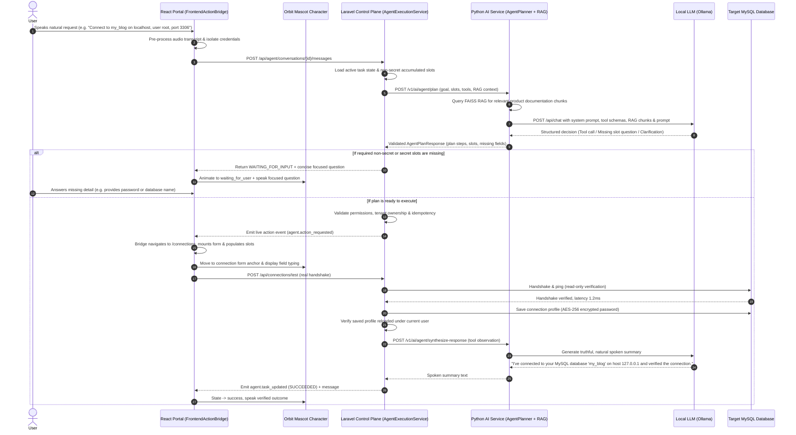

# AGENTIC_ARCHITECTURE.md
## Target Agentic Control Plane & Operational Architecture

**Scope:** Canonical interaction between User, Frontend Operation Bridge, Laravel Control Plane, and Python AI Service.

---

### 1. Architectural Principles

1. **Model Reasons, Application Governs:**
   The LLM (Ollama `llama3.2:1b` / `llama3:latest` locally, or user-configured cloud provider) interprets natural language, resolves semantic slots, retrieves relevant product knowledge, and selects typed tools. The Laravel application and frontend control plane own authorization, tenant scoping, real form state, schema inspection, database transactions, and data integrity.
2. **Real Tool Loop with Observed Outcomes:**
   Every tool execution produces a typed observation (`success`, `status`, `data`, `safe_summary`, `error_category`). The observation is returned to the orchestrator and model to decide the next step or synthesize truthful speech.
3. **Visibly Operated Portal:**
   Visual mascot travel and UI animations are synchronized with real frontend component events through a typed `FrontendActionBridge`. Motion reflects actual state; it is never a substitute for backend execution.
4. **Zero Shared Secrets in Conversational History or LLM Prompts:**
   Database passwords, cloud API keys, and sensitive tokens are routed through isolated secure capture handlers and encrypted at rest using Laravel's application encryption. They are excluded from prompts, RAG indexes, logs, events, and TTS audio.

---

### 2. End-to-End Orchestration Sequence

---

### 3. Layer Responsibilities

| Subsystem | Responsibilities | Forbidden Activities |
|---|---|---|
| **React Frontend** | Captures voice, manages `FrontendActionBridge`, dispatches component actions (`open_form`, `fill_fields`, `trigger_test`), animates mascot based on real SSE lifecycle events, renders masked inputs. | No direct customer DB connections, no bypassing Laravel authentication, no fake success toasts. |
| **Laravel Control Plane** | Authoritative user session, tenant isolation, DB credential encryption at rest, tool registry execution, queue worker, scheduler, audit logs, idempotency enforcement, safe parameterized SQL only. | Never execute customer `DROP`, `DELETE`, `TRUNCATE`, `ALTER`, or AI-generated SQL. |
| **Python AI Service** | RAG indexing/retrieval with FAISS, prompt assembly, Ollama client integration, structured Pydantic decision validation, response synthesis. | No direct customer database access, no storing credentials in plaintext logs or vector indexes. |
