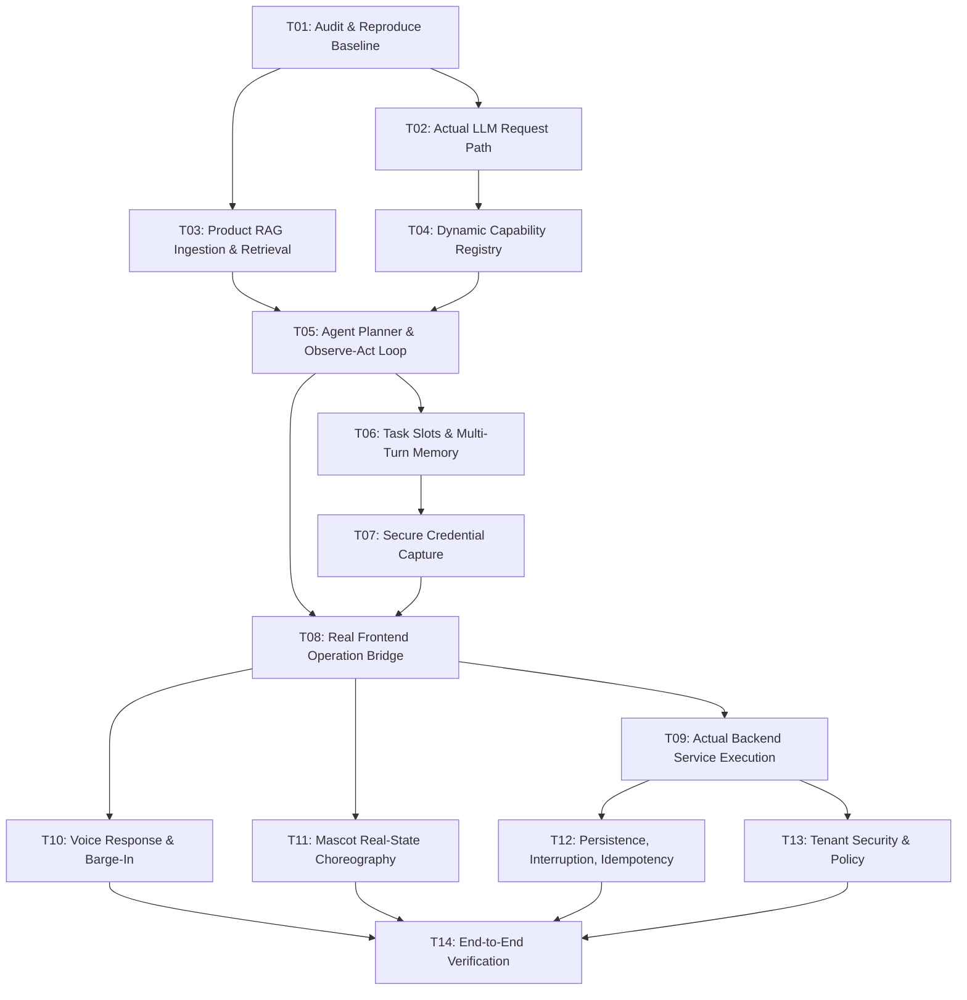

# IMPLEMENTATION_PLAN.md
## Master Implementation Plan: Agentic Voice-First Website Operator

---

### Task Breakdown & Dependencies

| Task | Title | Description | Status |
|---|---|---|---|
| **T01** | Audit & Reproduce Baseline | Document confirmed defects, baseline tests, and reproduction cases. | **VERIFIED** |
| **T02** | Actual LLM Request Path | Wire LLM (Ollama / Cloud) into planner, passing actual user utterance. | **NOT_STARTED** |
| **T03** | Product RAG Ingestion & Retrieval | Index `PRODUCT_CONTEXT_RAG.md` into FAISS and retrieve relevant chunks into planner prompt. | **NOT_STARTED** |
| **T04** | Dynamic Capability Registry | Unify tool schemas and handlers between Laravel and FastAPI without keyword routing. | **NOT_STARTED** |
| **T05** | Agent Planner & Tool Loop | Implement reasoning loop with Pydantic decision models and observed tool results. | **NOT_STARTED** |
| **T06** | Task Slots & Multi-Turn Memory | Retain spoken slots, detect missing required parameters, ask focused questions. | **NOT_STARTED** |
| **T07** | Secure Credential Capture | Isolate passwords from LLM/transcripts; encrypt at rest; zero-secret logs. | **NOT_STARTED** |
| **T08** | Real Frontend Operation Bridge | Implement `FrontendActionBridge` in React to open forms, fill fields, and trigger actions. | **NOT_STARTED** |
| **T09** | Actual Backend Service Execution | Execute real backend operations (`test`, `save`, `scan`), observe real responses. | **NOT_STARTED** |
| **T10** | Voice Response & Barge-In | Natural synthesized speech from verified results; instant speech interruption. | **NOT_STARTED** |
| **T11** | Mascot Real-State Choreography | Choreograph mascot states strictly to real SSE and frontend bridge events. | **NOT_STARTED** |
| **T12** | Persistence, Interruption, Idempotency | Persist tasks, support plan versioning, handle mid-flight stops and safe compensation. | **NOT_STARTED** |
| **T13** | Tenant Security & Policy | Enforce strict tenant boundaries, block destructive SQL, audit operations. | **NOT_STARTED** |
| **T14** | End-to-End Verification | Execute full acceptance scenarios (A, B, C, D) and verify passing criteria. | **NOT_STARTED** |
