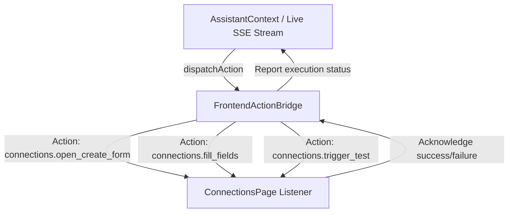

# LIVE_WEBSITE_OPERATIONS.md
## Real Website Operations & Frontend Action Bridge

**Objective:** Enable the agent to visibly and authentically operate the portal's pages, forms, and buttons through typed application actions without DOM hackery or arbitrary JavaScript.

---

### 1. Architecture of FrontendActionBridge

The `FrontendActionBridge` is a typed, event-driven service located in `frontend/src/services/actionBridge.ts`.
Pages and interactive components register their handlers with the bridge on mount and unregister on unmount.

---

### 2. Registered Action Catalog

| Action Key | Owning Component / Route | Arguments | Expected Outcome |
|---|---|---|---|
| `navigation.goto` | `Layout` / All Routes | `{ route: string }` | React Router changes location and page mounts. |
| `connections.open_create_form` | `ConnectionsPage` (`/connections`) | `{}` | Sets `showModal = true`, resetting form for new entry. |
| `connections.fill_fields` | `ConnectionsPage` (`/connections`) | `{ name, host, port, database_name, username, password? }` | Updates form state, animates field population, triggers client validation. |
| `connections.trigger_test` | `ConnectionsPage` (`/connections`) | `{}` | Clicks/triggers test connection handler and waits for actual result. |
| `connections.submit_save` | `ConnectionsPage` (`/connections`) | `{}` | Submits form to `api.createConnection()`, reloads connections list. |
| `automations.open_builder` | `AutomationBuilderPage` (`/automations/new`) | `{}` | Mounts automation wizard. |
| `automations.fill_config` | `AutomationBuilderPage` (`/automations/new`) | `{ name, connection_id, target_table, topic }` | Updates wizard form state. |
| `approvals.review_version` | `ApprovalsPage` (`/approvals`) | `{ execution_id, version_id }` | Selects content version for review. |

---

### 3. Safety Guarantees

1. **No Arbitrary Selectors or Code Execution:**
   The bridge rejects any action not in the registered action catalog. The LLM can never provide raw CSS selectors, XPath, or JavaScript strings.
2. **Component Lifecycle Awareness:**
   If an action target is not mounted (e.g. attempting to fill connection fields while on `/dashboard`), the bridge returns `TARGET_NOT_MOUNTED` with an automatic retry or recovery prompt.
3. **Synchronized Mascot Anchors:**
   Each action correlates with a semantic anchor (e.g. `connection-form-anchor`), allowing `OrbitMascotCharacter` to float near the active work area during execution.
